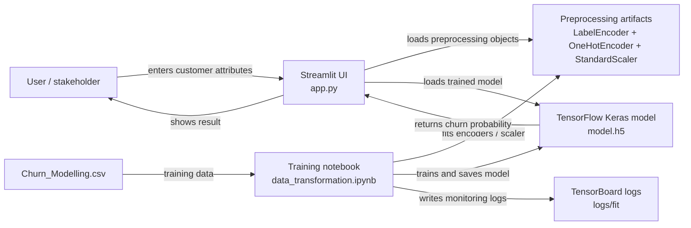
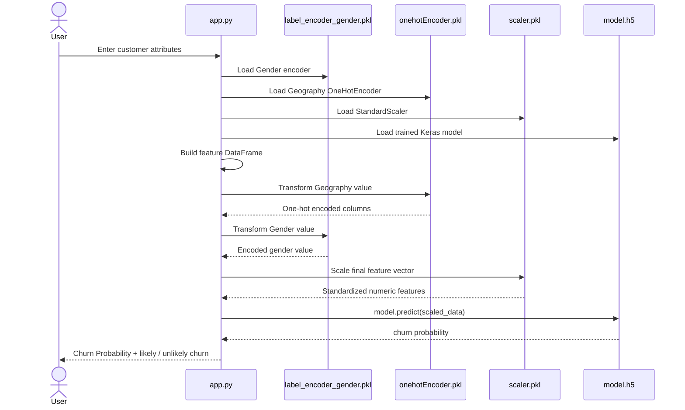

# Repository Architecture Report

## Repository overview
This repository is a compact Streamlit ML app that predicts customer churn for a bank using a saved TensorFlow/Keras model. The app depends on local preprocessing artifacts created in a Jupyter notebook rather than a formal backend service or database. The runtime path is a single Python file (`app.py`) that loads `model.h5`, `label_encoder_gender.pkl`, `onehotEncoder.pkl`, and `scaler.pkl`, collects user input from the browser, transforms the input, and runs inference.

### Stack
- Python
- Streamlit
- TensorFlow / Keras
- scikit-learn
- pandas + numpy
- Jupyter Notebook for training and preprocessing

### Main files and responsibilities
- `app.py` — Streamlit web app and inference runtime
- `data_transformation.ipynb` — training pipeline, feature preprocessing, model creation, artifact persistence
- `model.h5` — trained Keras model used at inference time
- `label_encoder_gender.pkl` — Gender label encoder
- `onehotEncoder.pkl` — Geography one-hot encoder
- `scaler.pkl` — StandardScaler fit on training features
- `Churn_Modelling.csv` — training dataset
- `requirements.txt` — Python dependencies
- `README.md` — local setup and project description

## Verified architecture

### High-level system view


### Detailed component architecture
```mermaid
flowchart TB
    subgraph Presentation[Presentation Layer]
        UI[Streamlit Web App\napp.py]
        Widgets[Input widgets\nGeography, Gender, Age, Balance, ...]
        Result[Prediction output\nChurn Probability + verdict]
    end

    subgraph Runtime[Application Layer]
        LoadModel[Load model.h5]
        LoadArt[Load pickle artifacts\nlabel_encoder_gender.pkl\nonehotEncoder.pkl\nscaler.pkl]
        BuildFrame[Assemble feature DataFrame]
        Transform[Apply preprocessing\nGender -> LabelEncoder\nGeography -> OneHotEncoder\nAll numeric features -> StandardScaler]
        Predict[Run model.predict()]
    end

    subgraph Data[Data & Model Artifacts]
        Dataset[Churn_Modelling.csv]
        GenderEnc[label_encoder_gender.pkl]
        GeoEnc[onehotEncoder.pkl]
        Scale[scaler.pkl]
        ModelFile[model.h5]
    end

    subgraph Training[Training Pipeline]
        Notebook[data_transformation.ipynb]
        Train[Train Sequential DNN\nDense(64) -> Dense(32) -> Dense(1)]
        Save[Save model + encoders + scaler]
        TB[TensorBoard logs\nlogs/fit]
    end

    UI --> Widgets
    Widgets --> BuildFrame
    LoadArt --> GenderEnc
    LoadArt --> GeoEnc
    LoadArt --> Scale
    LoadModel --> ModelFile
    BuildFrame --> Transform
    GenderEnc --> Transform
    GeoEnc --> Transform
    Scale --> Transform
    Transform --> Predict
    ModelFile --> Predict
    Predict --> Result

    Notebook --> Dataset
    Notebook --> Train
    Train --> ModelFile
    Train --> Save
    Save --> GenderEnc
    Save --> GeoEnc
    Save --> Scale
    Train --> TB
```

### End-to-end data flow


## Evidence and source references
- `README.md` describes the project as a Streamlit customer churn app and documents the execution flow and required artifacts.
- `app.py` loads the model and preprocessing objects from the repo root and creates a Streamlit UI with user inputs. It executes `scaler.transform(input_data)`, then `model.predict(input_data_scaled)`, and renders a probability threshold.
- `data_transformation.ipynb` demonstrates data ingestion from `Churn_Modelling.csv`, `LabelEncoder` for `Gender`, `OneHotEncoder` for `Geography`, `StandardScaler` for numerical features, model training via a `Sequential` Keras model, and serialization of the artifacts (`pickle.dump(...)` + `model.save("model.h5")`).
- `requirements.txt` confirms the runtime stack: `tensorflow`, `pandas`, `numpy`, `scikit-learn`, `streamlit`, `tensorboard`, `matplotlib`, `scikeras`.

## Architecture findings
- This is a single-process inference app; there is no separate backend API, database, or persistent web service layer in the repository.
- Persistence is file-based: model and preprocessing artifacts live on disk in the project root along with the dataset and TensorBoard logs.
- The training notebook is a separate step from the runtime app; the notebook creates the model/encoders/scaler and leaves them in the repo for the Streamlit app to consume.
- There are no tests, CI/CD workflows, Dockerfiles, or deployment manifests in the repository root; deployment is effectively local or Streamlit Cloud based on the README, but repository evidence does not show a formal cloud deployment configuration.
- There is no authentication or authorization flow; this is a plain local interactive inference application.

## Uncertainties and limitations
- No explicit deployment config or cloud runtime manifest was found in the repo, so deployment details are inferred from the README and the app structure rather than a formal deployment definition.
- The project has no database, API router, or microservice boundary; it is intentionally minimal and self-contained.
- The app uses a fixed threshold (`> 0.5`) for churn classification, which is implemented in `app.py`, but there is no dedicated evaluation or logging pipeline beyond TensorBoard training logs.

## Mermaid source files created
- `architecture-overview.mmd`
- `component-architecture.mmd`
- `data-flow.mmd`

## Direct evidence path summary
- `README.md`
- `app.py`
- `data_transformation.ipynb`
- `requirements.txt`
